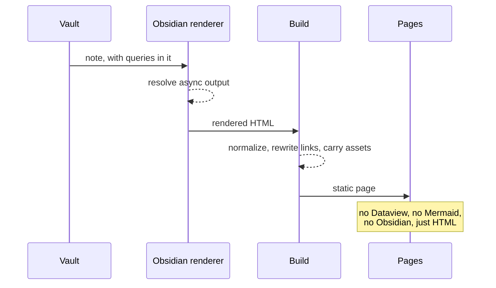
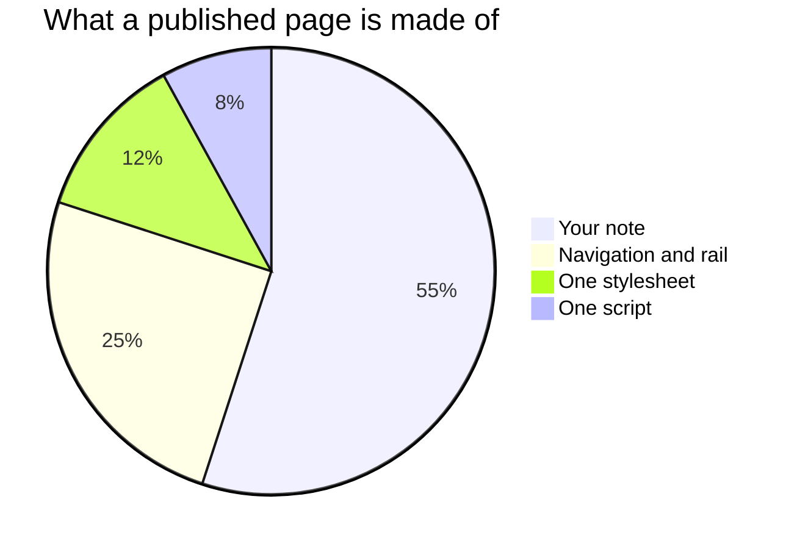

# Mermaid and code

Build this page and compare it with what you see in Obsidian. If they match,
the two things that are hardest to publish both survived.

## A diagram

Mermaid output exists only as the SVG a running Mermaid drew. No Markdown
converter can produce it.



A second one, to check that two diagrams on one page both arrive:



> [!warning] Diagrams publish light-themed
> Resolved colours from Mermaid's default light theme are baked into the SVG,
> so on a dark site these will look wrong. → [[Known limits]]

> [!note] If they come out empty
> Obsidian 1.14 gates diagram rendering per vault, and the plugin reports that
> rather than working around it. Allow diagrams for this vault and build again.

## Highlighted code

Syntax highlighting is also the app's work rather than something in the
Markdown, so it is worth checking too.

```typescript
export function tagSlug(name: string): string {
  return name
    .toLowerCase()
    .replace(/[^a-z0-9]+/g, "-")
    .replace(/^-+|-+$/g, "");
}
```

```css
:root {
  --osp-link: #a8431a;
  --osp-measure: 64ch;
}
```

```sh
npm run build
npm run deploy /path/to/your/vault
```

```yaml
updated: 2026-11-07
pinned: false
tags:
  - example
```

## A table, a callout and a quote

Because they are the other things that look different once styled.

| Thing | Rendered by | Survives? |
| --- | --- | --- |
| Wikilink | the build | yes, rewritten to a relative URL |
| Dataview table | Dataview | yes, as a static table |
| Mermaid diagram | Mermaid | yes, as SVG |
| Bases sorting | Bases | no |

> [!tip] Callouts publish as callouts
> Including this one. A *collapsed* callout publishes in whichever state it was
> rendered, and stays that way.

> A plain blockquote, for comparison.

## Related

- [[Dataview, Bases and Mermaid]]: what survives, in general.
- [[A base, embedded]]: the Bases half of this test.
- [[Rendering inside Obsidian]]: why any of it works.
