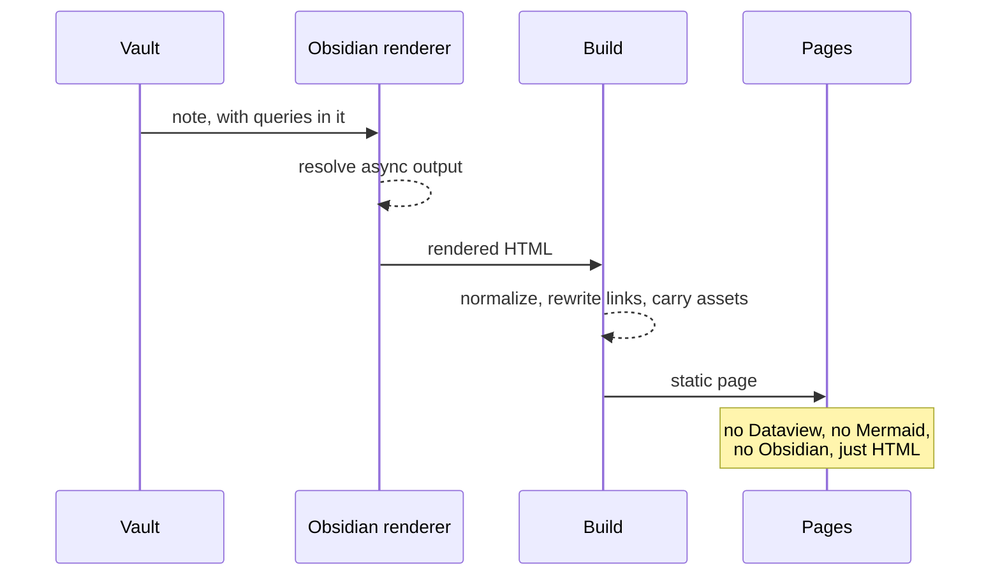
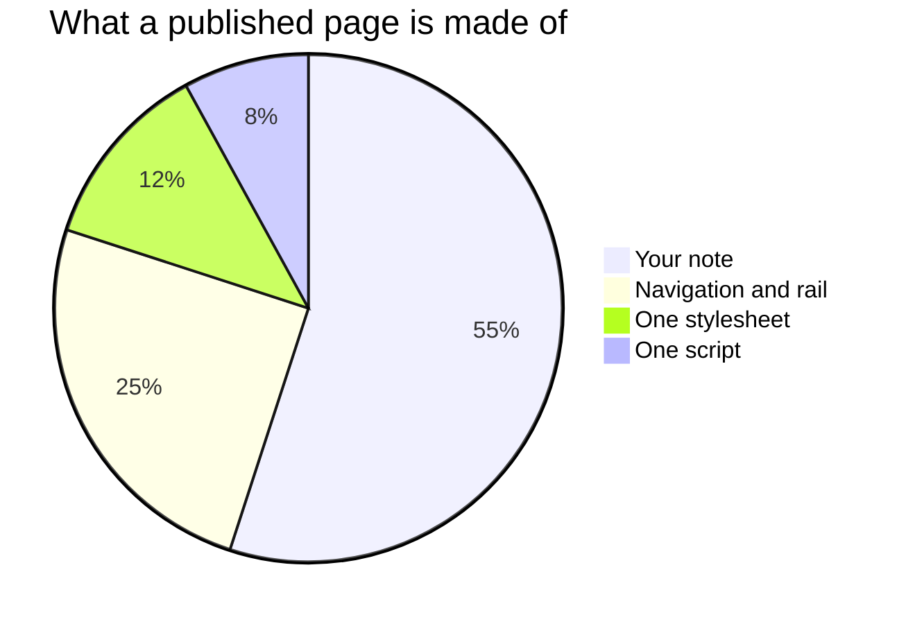

# See it working

Every kind of content the plugin publishes, on one page. Build a preview
and compare it with what you see in Obsidian: each section says what to look
for and links to the note that explains it.

## A working prototype, inside the note

An `.html` page embedded the way you would embed an image. In Obsidian it is
a box with the file's name in it. On the published page it is the prototype
itself, with **Phone**, **Tablet**, **Desktop** and **Fit** buttons above it.

![[prototype/basket.html|375x700]]

Try each width: the basket is one column on a phone, gains a summary panel
from tablet width up, and its delivery options change from a bottom sheet to
a drawer. The `|375x700` after the name starts it at phone width, 700 pixels
tall.

> [!note] This needs Publish HTML files as-is
> It is on in this vault. In your own it is off by default, and without it
> the prototype is not published, so the embed stays the box Obsidian drew.

> [!tip] Leave a comment on it
> With **Include a review overlay** on as well, the note gets one review
> toolbar, and pins land on the prototype's own buttons and rows.
> [[About the prototype demo]] lists what to try.

→ [[Publishing a built app]]

## Diagrams

Mermaid output exists only as the SVG a running Mermaid drew. No Markdown
converter can produce it.



A second one, to check that two diagrams on one page both arrive:



> [!warning] Diagrams publish light-themed
> Resolved colours from Mermaid's default light theme are baked into the SVG,
> so on a dark site these will look wrong. If they come out empty, Obsidian is
> asking you to allow diagrams in this vault. → [[Known limits]]

## A Bases view

`Notes.base` filters this vault down to the notes tagged `#feature` and shows
each one's name, tags and `updated` date. Published, it becomes a plain
table: the view as it was when the page was built, without sorting or view
switching.

![[Notes.base]]

> [!note] This one needs Bases
> Bases ships with recent Obsidian versions. Without it, the embed does not
> render, and the published page says so rather than leaving a blank space.

## A Dataview query

The same list as the base, asked of Dataview:

```dataview
TABLE updated AS "Updated", tags AS "Tags"
FROM #feature
SORT updated DESC
```

> [!note] This one needs Dataview
> Dataview is a community plugin, and this vault does not install it for you.
> Without it, the block above stays a code block, in Obsidian and on the
> published page. Install and enable Dataview, build again, and it publishes
> as a table.

**`dataviewjs`** runs JavaScript, so Dataview leaves it off until you turn it
on in Dataview's own settings. A block like this one, once allowed, publishes
as whatever it drew. Shown here as plain code, so it never runs:

```js
// In a ```dataviewjs block:
dv.list(dv.pages("#feature").sort(p => p.updated, "desc").file.link);
```

Anything interactive it draws, such as a button, does nothing once
published, and if the script fails, its error message is published.

→ [[Dataview, Bases and Mermaid]]

## Highlighted code

Syntax highlighting is also the app's work rather than something in the
Markdown, so it is worth checking too.

```typescript
export function tagSlug(name: string): string {
  return name
    .toLowerCase()
    .replace(/[^a-z0-9]+/g, "-")
    .replace(/^-+|-+$/g, "");
}
```

```css
:root {
  --osp-link: #a8431a;
  --osp-measure: 40rem;
}
```

```yaml
updated: 2026-11-23
pinned: 2
tags:
  - example
```

## Tables, callouts and quotes

Because they are the other things that look different once styled.

| Thing | Rendered by | Survives? |
| --- | --- | --- |
| Wikilink | the build | yes, rewritten to a relative URL |
| Dataview table | Dataview | yes, as a static table |
| Mermaid diagram | Mermaid | yes, as SVG |
| Bases sorting | Bases | no |
| Embedded prototype | the build | yes, framed, with width buttons |

> [!tip] Callouts publish as callouts
> Including this one. A *collapsed* callout publishes in whichever state it was
> rendered, and stays that way.

> A plain blockquote, for comparison.

## Related

- [[Dataview, Bases and Mermaid]]: what survives, in general.
- [[Rendering inside Obsidian]]: why any of it works.
- [[About the as-is demo]]: a page published on its own, byte for byte.
- [[About the prototype demo]]: the prototype above, and reviewing it.
