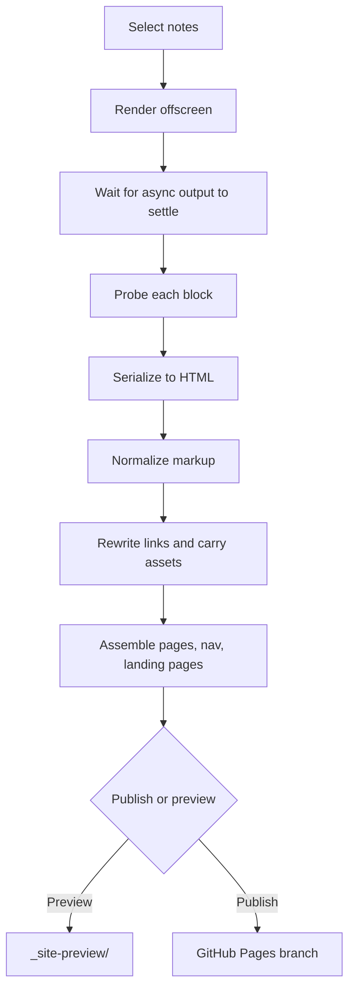

# Rendering inside Obsidian

Every other Markdown publisher converts your notes outside the app. This one
does not, and that single decision is behind most of what the plugin can do
and most of what it cannot.

## Why

Dataview, Datacore, Bases and Mermaid output **does not exist in your
Markdown**. It exists only as the result of code running inside a live
Obsidian. A publisher that reads the files and converts them has to
reimplement all of it, which is why the alternatives either skip those
features or hand you a static-site generator and leave it to you.

So the plugin renders each note through Obsidian's own renderer, waits for the
asynchronous parts to finish, and serializes whatever came out. The output is
the app's own HTML, so a Dataview table publishes as a table and a Mermaid
diagram publishes as the SVG Mermaid drew.

The cost, stated honestly:

- Publishing happens only from a running desktop Obsidian.
- Nothing can rebuild the site on a server.
- There is no GitHub Actions workflow, and there will not be: a CI build
  cannot render Dataview, so it would have nothing to do. (Actions is also
  blocked on plenty of corporate networks, which is one of the places this is
  meant to be useful.)

## The sequence

That diagram is itself the feature. It is Mermaid, it is rendered by the
Mermaid that ships with Obsidian, and if you are reading this on the published
site then it survived the trip as an SVG.

## Knowing when a page is finished

The hard part is not rendering, it is knowing when rendering has *stopped*.
A Dataview query resolves asynchronously; photograph the page too early and
you publish an empty block.

A fixed timer would be wrong in both directions: too slow for a simple note,
too fast for a heavy one. So the wait is content-aware: it watches what the
page is doing and settles when the output stops changing, rather than when a
clock runs out.

Three things then check the result:

- **A probe per block**, reporting one of four states: `ok`, `empty`, `error`
  or `blocked`. An empty Dataview block is reported rather than quietly
  published blank.
- **A stylesheet probe**, recording which stylesheets were readable and whose
  they were. The plugin lifts layout-critical rules out of the running app,
  and needs to know what it could and could not see.
- **Drift detection**, for a build that degrades as it runs. A long publish
  session can damage its own environment, and a build whose later pages are
  worse than its earlier ones is a specific failure worth naming.

## When something renders wrongly

Two commands exist for exactly this:

- **Report render timings** tells you how long each note in the publish scope
  took. If one note is responsible for a slow build, this is how you find it.
- **Diagnose** samples a single note's render *over time*, so you can see a
  block arrive, or fail to. It needs to be told which note, because the note
  worth sampling is whichever one is rendering wrongly. Set `diagnosePath` in
  the plugin's `data.json` beside `autoRun: "diagnose"`.

See [[Commands and automation]] for driving those from outside the app.

## Deterministic output

Obsidian generates random ids per render. A publisher that kept them would
produce a different file on every build, which would defeat incremental
publishing entirely: every page would look changed.

So the ids are replaced with deterministic ones derived from the content. Two
builds of an unchanged note produce byte-identical HTML, which is what makes
[[Publishing to GitHub Pages|the incremental upload]] possible.

## Related

- [[Dataview, Bases and Mermaid]]: what survives, specifically.
- [[Pages the build writes for you]]: what happens to the rendered HTML next.
- [[Known limits]]: including the scale question, which is open.
